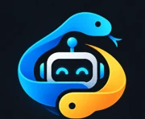
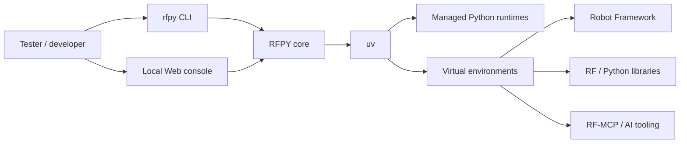
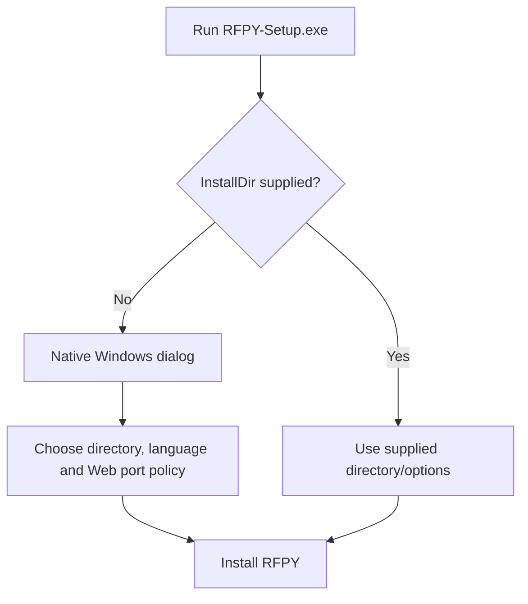
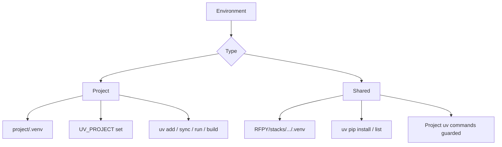
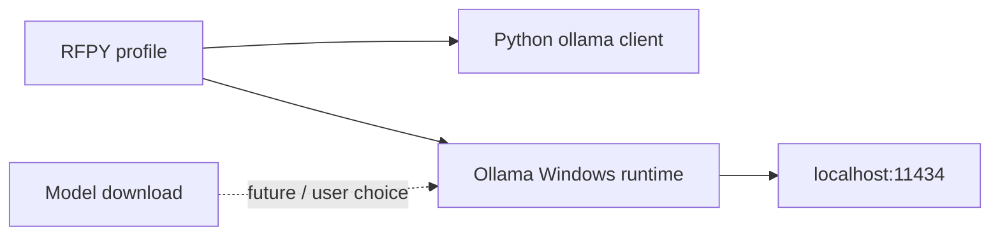

**Copyright © 2026 Olivier RENAULT — Apache-2.0**

<p align="center">
  
</p>

# RFPY

**RFPY** is a Windows environment manager focused on **Python + Robot Framework**.
It uses **uv** as its engine and provides both a lightweight CLI and a local Web console to create, inspect, reproduce and maintain Robot Framework environments.

RFPY is designed for testers and automation engineers who need several Python / Robot Framework stacks without turning every environment setup into a manual sequence of downloads, `pip` commands and browser initialization steps.

> Stable public release: **1.0.0**

## Why RFPY?

Robot Framework projects often combine several moving parts: Python, Robot Framework itself, Browser Library / Playwright, Selenium, API and database libraries, local keywords, corporate package repositories, certificates, proxies and now AI tooling.

RFPY provides one place to manage that technical stack while keeping the project itself readable and portable.



## Main capabilities

RFPY 1.0.0 provides:

- isolated Python / Robot Framework environments;
- **Project** and **Shared** environment modes;
- native `uv` project behavior for project environments;
- a fast activation menu with `rfpy` and a management menu with `rfpy -m`;
- a local Web console for installation, environment management, profiles, settings and diagnostics;
- selectable Python and Robot Framework versions;
- Browser Library / Playwright and Selenium stacks;
- Robot Framework library profiles;
- reproducibility exports: `requirements.txt`, `pyproject.toml` and CycloneDX SBOM;
- configurable PyPI-compatible repositories, including private Nexus / Artifactory-style indexes;
- proxy and custom CA support;
- multilingual UI: French, English, German, Spanish and Chinese;
- RF-MCP profiles for AI-assisted Robot Framework workflows;
- optional Ollama runtime deployment, **without downloading a model**;
- a `doctor` command usable from both CLI and Web.

## Installation

### Recommended: GitHub Release

Download **`RFPY-Setup.exe`** from the latest GitHub Release and run it.

When no installation directory is passed, the installer displays a native Windows dialog with:

```text
C:\RFPY
```

as the default path. The directory can be changed with the **Browse** button. The dialog uses the RFPY application icon, displays the RFPY copyright/version, and offers the same five UI languages as the Web console: French, English, German, Spanish and Chinese. The selected installer language is persisted as the initial language for both the RFPY CLI and Web console. The same dialog also lets you keep the default **automatic Web port** policy (first free port starting at 8765) or select a fixed port when required.



For unattended or scripted installation, pass the directory explicitly:

```powershell
.\RFPY-Setup.exe -InstallDir "D:\Tools\RFPY"

# Optional fixed Web port; 0 keeps automatic allocation
.\RFPY-Setup.exe -InstallDir "D:\Tools\RFPY" -WebPort 8877
```

The PowerShell source installer can also be run directly:

```powershell
.\installer\rfpy-installer.ps1 -InstallDir "D:\Tools\RFPY"
```

The directory selector is shown **only when the installation directory is not supplied**.

After installation, open a new PowerShell and run:

```powershell
rfpy
```

If no environment exists yet, RFPY opens the Web console automatically.

## CLI

Common commands:

```powershell
rfpy                     # quick environment selector / activation
rfpy -m                  # management menu
rfpy list                # static environment list
rfpy status              # current environment
rfpy doctor              # diagnostics in the terminal
rfpy web                 # open the local Web console
rfpyw                    # direct shortcut to the local Web console
rfpy language            # interactively select CLI/Web language
rfpy language en         # set CLI/Web language directly
rfpy off                 # deactivate the current RFPY environment
```

Create a project environment:

```powershell
rfpy project add C:\dev\my-project --python 3.14 --robot latest --profile playwright
```

Create a reusable shared environment:

```powershell
rfpy install RF-TOOLS --type shared --python 3.14 --robot latest --profile robot
```

Activate a known environment directly:

```powershell
rfpy activate MY-ENV
```

The detailed help is shared by `cmd.exe` and PowerShell and follows the configured language. Root and command-specific forms are supported, for example `rfpy -h`, `rfpy --help`, `rfpy install -h`, `rfpy project add -h` and `rfpy help install`. Pressing **Esc** in the quick selector now simply returns to the prompt; the Web console is opened automatically only when no RFPY environment exists.

PowerShell and `cmd.exe` use the same keyboard-oriented selection behavior. In `cmd.exe`, environment activation metadata is exchanged through a dedicated internal command rather than inline `python -c` quoting, so activation persists in the current CMD session without the former quoting failure.

Language is a **global RFPY setting**, not an environment property. In the quick selector and management selector, press **F2** to open the same arrow-key language selector; the current language is shown in green. The active environment is also shown in green. `rfpyw` is provided as a short direct alias for `rfpy web` and its startup/stop messages follow the configured language.

## Project vs Shared

RFPY deliberately distinguishes two use cases.



### Project

A Project environment belongs to one project directory.

Typical layout:

```text
my-project/
├── pyproject.toml
├── uv.lock
├── tests/
└── .venv/
```

When activated, RFPY points `UV_PROJECT` to the linked project so standard uv project commands operate on the expected project.

A Project environment can also be created before a project directory is linked. RFPY then keeps it in a protected **project-pending** state until the project folder is assigned.

### Shared

A Shared environment is reusable and remains under the RFPY root.

Use `uv pip` operations with it. RFPY protects project-oriented commands such as `uv sync`, `uv add`, `uv lock` and `uv build` to reduce accidental synchronization against an unrelated current directory.

## Web console

Run:

```powershell
rfpy web
```

The Web console is local-only. By default the configured port is **automatic**: RFPY tries 8765 first, then the following ports until it finds a free one. The actual URL is printed when `rfpy web` / `rfpyw` starts. A fixed port can be selected in **Settings** or during installation; if that fixed port is busy, RFPY reports the conflict instead of silently opening another application.

It contains five main areas:

- **Environments** — inspect, rename, duplicate, delete, change type and link project folders;
- **Installation** — create Project or Shared environments;
- **Profiles & libraries** — install Robot Framework / Python tooling, import `requirements.txt` / `pyproject.toml`, save reusable profiles and follow profile installation without leaving the tab;
- **Settings** — repositories, proxy, custom CA, defaults, version filters and safe package-install behavior;
- **Doctor** — installation and environment diagnostics.

RFPY uses an **integrated Web folder browser** for project-directory selection. This avoids browser / desktop focus issues while still giving the local backend the real Windows path.

## Installation profiles

RFPY includes reusable profiles such as:

```text
Python - Utilitaires
RF Web - Playwright
RF Web - Selenium
RF API
RF Data
RF Database
RF SSH
RF Quality / Parallel
IA / LLM
IA / LLM + Ollama
```

### Importing a profile from an existing project

The **Profiles & libraries** tab can import either:

- `requirements.txt`;
- `pyproject.toml` using `[project].dependencies`.

The import creates a reusable RFPY installation profile. Requirements directives such as nested `-r`, constraints, editable installs and index options are intentionally not imported automatically; RFPY reports them as warnings instead of guessing. Optional dependency groups from `pyproject.toml` are also left explicit for now.

Profile installation stays in the **Profiles & libraries** tab. Its execution log is shown in a collapsible section that opens when an installation starts.

### Python - Utilitaires

Installs a minimal convenience set:

```text
PyYAML
python-dotenv
```

### IA / LLM

Installs:

```text
rf-mcp
PyYAML
python-dotenv
```

RFPY intentionally installs **RF-MCP into the selected RFPY environment**, instead of using an isolated global `uv tool` environment. This allows RF-MCP to run with the same Python interpreter and to see the Robot Framework libraries available in that Project or Shared environment.

This applies to both environment types: **Project** and **Shared**. RFPY installs the AI tooling into the selected environment's venv. For a Project environment, this tooling installation does not rewrite the project's `pyproject.toml` by default; the goal is to make RF-MCP see the project environment without silently changing the project's declared application dependencies.

RFPY does **not** automatically modify Copilot, Claude, Codex, Cursor or other agent configuration files. Agent registration remains an explicit user action, for example from the project directory:

```powershell
robotmcp install --agents copilot --scope project
```

Use RF-MCP's own `doctor` when you need to inspect the launch it resolved for a project.

### IA / LLM + Ollama

Adds the Python `ollama` client and installs the official **Ollama Windows runtime** if it is not already available.

This profile **does not download any LLM model**.

That distinction is intentional:



Ollama itself can be installed and present without any model. A model is only required when you actually want to perform inference. Model selection, Hugging Face integration, hardware-aware recommendations and model download management are intentionally left for a later RFPY evolution.

## Browser Library

The Playwright technical stack installs:

```text
Robot Framework
robotframework-browser
robotframework-browser-batteries
Chromium
```

RFPY runs the Browser initialization step during deployment.

A smoke test can then be launched from the Web console with or without headless mode.

## Native build fallback on Windows

Some Python packages fall back to a source build when no compatible wheel is selected. On Windows this can fail with a message such as:

```text
Microsoft Visual C++ 14.0 or greater is required
```

RFPY keeps normal package installation as the default. When that specific MSVC build error is detected, and the option is enabled in **Settings**, RFPY retries **only the package that failed to build** with uv's `--only-binary` option. If a compatible wheel exists, the original installation resumes. If no compatible wheel exists for that Python / platform combination, RFPY stops with an explicit explanation.

RFPY deliberately does **not** force `--only-binary :all:` for every package because that would reject valid source-only packages and could break private/internal dependencies.

For prerelease/new Python versions, a package may simply have no compatible wheel yet. In that case the fallback fails cleanly rather than attempting an administrator-dependent compiler installation; using a Python branch supported by the package's published wheels is normally the safest choice.

## Cancelling an installation

Long-running installation jobs can be stopped from the Web console. RFPY terminates the current process tree.

For a **new environment**, if the `.venv` did not exist before the operation and the cleanup option is enabled, RFPY removes the incomplete environment after cancellation. A pre-existing project `.venv` is never deleted by this cleanup.

For an **existing environment** being completed from **Profiles & libraries**, cancellation stops further work but does not claim a transactional rollback: packages already applied are kept. Full package-state rollback is deliberately deferred until it can be implemented without risking user-managed environments.

## Repositories, proxy and certificates

RFPY can work with:

- public PyPI;
- private PyPI-compatible indexes;
- Nexus repositories;
- Artifactory repositories;
- generic PEP 503 compatible indexes.

Private/enterprise repositories are **disabled by default**. Settings and repository configuration are presented in one vertical page: public PyPI first, then private Nexus / Artifactory / Generic indexes, followed by proxy, CA, Web port, install safety, version filters and defaults. The **Save** action is at the top because it applies to the whole Settings page.

Add one or more private repositories and provide a **Simple / PEP 503 URL** (the URL used by uv/pip). Several private indexes may be enabled at the same time; their numeric priority controls the order passed to uv. A private row starts disabled, and RFPY refuses to save any enabled repository without a valid `http://` or `https://` Simple URL. An optional Browse/API URL can be supplied for package discovery. Public PyPI remains independently configurable.

The Web console also tracks unsaved Settings changes: the page marks the configuration as modified and warns before **Quit** (and before browser unload) when changes have not been saved. Existing configurations created with the old default are still treated as private-repository disabled when they contain only public PyPI and no private URL.

Proxy and custom CA settings are centralized in RFPY and propagated to the relevant subprocesses.

A CA selected from the Web UI is copied into RFPY-managed configuration storage so the configuration does not depend on the original source path.

## Reproducibility and SBOM

For an environment, RFPY can generate:

```text
requirements.txt
pyproject.toml
CycloneDX JSON SBOM
```

The SBOM includes Python packages and dependency relations, CPython, uv and npm components discovered in BrowserBatteries where applicable. It also records **Olivier RENAULT** as the RFPY author and Apache-2.0 as the project license.

The CycloneDX SBOM is an inventory, not yet a vulnerability scan. **OSV vulnerability lookup remains deliberately deferred** in 1.0.0 and is tracked in `TODO.md`; this avoids silently adding a remote security-service dependency to normal environment inspection.

The **Open** action launches the system-associated application detached from the `rfpy web` console, so GUI application logs (for example VS Code / Electron messages) do not pollute the RFPY terminal.

## Doctor

Run:

```powershell
rfpy doctor
```

The CLI version prints its result directly in PowerShell / cmd.

Doctor checks include, among other things:

- RFPY root writability;
- uv availability;
- PATH state;
- configured repositories;
- installed environments;
- Project / Shared consistency;
- project `.venv`, `pyproject.toml` and `uv.lock` state;
- Web port availability;
- RF-MCP command presence when installed;
- Ollama runtime presence when the Python client is installed.

JSON output is also available from the Python backend:

```powershell
rfpy doctor --json
```

## Directory layout

With the default installation path:

```text
C:\RFPY\
├── app\
├── bin\
├── config\
├── reports\
├── runtime\python\        # Python interne du manager
├── runtimes\python\       # Python gérés pour les environnements
├── stacks\
├── tools\uv\
└── .appvenv\
```

The global uv engine is installed once under RFPY. It is not duplicated into every environment.

## Repository layout

The repository root intentionally keeps project metadata and documentation separate from implementation files:

```text
RFPY/
├── .github/              # GitHub Actions
├── assets/               # icon and README branding
├── installer/            # standalone PowerShell installer source
├── src/                  # RFPY runtime sources
│   ├── rfpy.py
│   ├── default-config.json
│   ├── web/              # split Web UI sources
│   └── wrappers/         # rfpy / uv shell bridges
├── tests/                # unit and regression tests
├── tools/                # repository maintenance helpers
├── README.md
├── CHANGES.md
├── TODO.md
├── LICENSE
├── NOTICE
└── AUTHORS
```

The installed RFPY layout under `C:\RFPY` is unchanged by this source-tree organization.

## Building from source

Requirements for development:

- Windows;
- Python 3.13+ for validation;
- PowerShell 5.1+;
- `ps2exe` only when building the Windows executable.

Run the source tests:

```powershell
python -m pip install packaging
python -m unittest discover -s tests -v
```

Refresh the standalone installer's embedded payloads after changing RFPY source files:

```powershell
python tools\embed_payloads.py
```

Build the executable manually:

```powershell
Install-Module ps2exe -Scope CurrentUser -Force

Invoke-ps2exe `
    .\installer\rfpy-installer.ps1 `
    .\RFPY-Setup.exe `
    -x64 `
    -title "RFPY Installer" `
    -product "RFPY" `
    -version "1.0.0.0" `
    -iconFile .\assets\rfpy.ico
```

## GitHub Releases

The repository contains a GitHub Actions workflow under:

```text
.github/workflows/ci-release.yml
```

Every push / pull request validates Python, tests and PowerShell parsing.

A tag such as:

```text
v1.0.0
```

triggers a Windows release build that creates and publishes:

```text
RFPY-Setup.exe
RFPY-Setup.exe.sha256
```

as GitHub Release assets.

## Community value

RFPY does not try to replace uv, Robot Framework or individual Robot Framework libraries. It combines them into a reproducible environment workflow aimed specifically at Robot Framework users.

The project is intended to make it easier to:

- test several Python / Robot Framework combinations;
- create clean environments for demonstrations and training;
- share reproducible setup conventions across teams;
- experiment with Browser, Selenium, APIs and RF-MCP without polluting the system Python;
- diagnose broken environments consistently;
- support both small local projects and repository-controlled enterprise environments.

## License

RFPY is released under the **Apache License 2.0**.

Original author and project creator: **Olivier RENAULT**.

See [LICENSE](LICENSE), [NOTICE](NOTICE) and [AUTHORS](AUTHORS). The `NOTICE` file records the original authorship and is intended to be preserved in redistributions as required by Apache-2.0.

## Related projects

RFPY builds on or integrates with projects from the Python and Robot Framework ecosystem, including:

- [Robot Framework](https://robotframework.org/)
- [uv](https://docs.astral.sh/uv/)
- [Robot Framework Browser](https://robotframework-browser.org/)
- [RF-MCP / RobotMCP](https://github.com/manykarim/rf-mcp)
- [Ollama](https://ollama.com/)

These projects keep their own licenses and release cycles.
